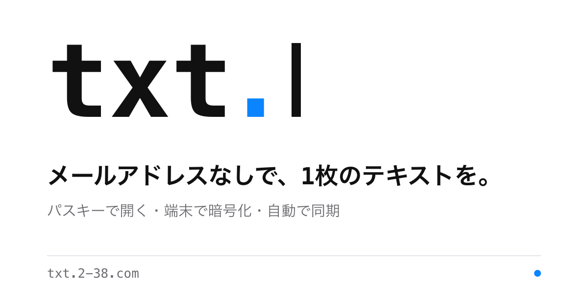

**English** · [日本語](./README.ja.md)

<p align="center">
  
</p>

<h1 align="center">txt</h1>

<p align="center">
  One sheet of text, no email address. Opened with a passkey, encrypted on your device.
</p>

<p align="center">
  <a href="https://txt.2-38.com"></a>
  
  
  
</p>

**txt** is a single-sheet memo at [txt.2-38.com](https://txt.2-38.com). There are no titles and no lists — open it and write. Text and attachments (photos, videos, audio) are encrypted in your browser before anything leaves the device, so the server only ever stores ciphertext.

The implementation standard is [`spec.md`](./spec.md) (spec version 1.4, Web-only). This repository implements **the Web app and the server (Worker) only** — it works in desktop and mobile browsers, with no native app to install. Development rules live in [`AGENTS.md`](./AGENTS.md).

## ✨ Features

- 📄 **One sheet** — a single document per account, saved and synced automatically; no titles, folders, or lists to manage
- 🔑 **Passkey only** — no email address, phone number, or password; sign in with a discoverable passkey (fingerprint, face, or device unlock)
- 🔐 **End-to-end encrypted** — a passkey PRF output derives a key-encryption key that wraps a random VaultKey; the server never receives plaintext, file names, MIME types, PRF output, or keys
- 🖼️ **Encrypted attachments** — photos, videos, and audio are encrypted per-file in chunks and streamed back with Range support
- 🌐 **Japanese / English UI** — the interface follows your browser language on first run and can be switched any time from the **More** menu; your choice is kept on the device
- 🤖 **AI agent connection** — your own AI agent can read and write the sheet through a local MCP server, without weakening the encryption (see below)
- 📱 **Responsive** — desktop and mobile browsers, including Apple-device WebAuthn/PRF and an encrypted-media Service Worker

## 🔐 How the encryption works

| Layer | What happens |
| --- | --- |
| Passkey (WebAuthn + PRF) | The PRF output never leaves the device |
| Key encryption key (KEK) | Derived from the PRF output with HKDF |
| VaultKey | A random 32-byte key, stored on the server only wrapped by the KEK |
| Document & media | Encrypted client-side (AES-GCM); the server stores ciphertext in D1 / private R2 |
| Recovery key | A `TXT1.`-format key shown once at registration — the only way back if every passkey is lost |

Sessions are Cookie-only. Saves use ETag compare-and-swap with mutation IDs, so two devices never silently overwrite each other — a conflict is surfaced and decided by you.

> [!NOTE]
> The server cannot verify plaintext. All content validation happens on the client, and the server is written to not trust it.

## 🤖 AI agent connection

You can let **your own AI agent** (for example Muse) work with your sheet:

- 🔒 **E2EE is preserved** — decryption happens only inside a small MCP server running on your own machine, in memory. The server side still sees ciphertext only.
- 🧑 **You stay in control** — adding an agent requires your passkey, a pairing code (10-minute expiry), a fingerprint comparison, and your choice of token scope (read-only, or read & write). Tokens expire after 30 days, and you can revoke an agent at any time from **More → Agents**.
- ✍️ **Writes are conservative** — appending is the default; replacements and rollback are approval-gated, and on a conflict the agent must show you the diff instead of merging or overwriting.

**Hand the guide to your agent:** the connection procedure is written for AI agents and served at stable URLs —

| Language | Guide |
| --- | --- |
| English | https://txt.2-38.com/agents.md |
| 日本語 | https://txt.2-38.com/agents.ja.md |

Canonical sources: [`skills/txt-agent/`](./skills/txt-agent/) (also the source of [`/llms.txt`](https://txt.2-38.com/llms.txt)). Implementation details: [`apps/agent-mcp/README.md`](./apps/agent-mcp/README.md).

## 🧱 Architecture

| Area | Implementation |
| --- | --- |
| Host / WebAuthn RP ID | `txt.2-38.com` |
| Server | Cloudflare Workers + Hono |
| Data | D1 (credentials, ciphertext, sync state), private R2 (encrypted attachments) |
| Sign-in | Discoverable passkeys — no email, phone, or password |
| Encryption | Client-side E2EE: VaultKey wrapped by a PRF-derived KEK |
| Web | HTML/CSS/JavaScript + a minimal ProseMirror set |
| Save & sync | Conditional HTTP updates (ETag) / short-interval polling / BroadcastChannel assist |

```
apps/
  web/          # editor, WebAuthn/PRF, crypto worker, media Service Worker, sync
  worker/       # Hono routing, auth, D1, R2, cleanup, security headers
  agent-mcp/    # local MCP server that bridges AI agents to the sheet (decrypts on-device)
packages/
  protocol/     # encoding, HKDF/AES-GCM contract, key derivation, document model, test vectors
migrations/     # D1 schema
skills/         # agent-facing skill documents (txt-agent connection guide, llms.txt)
tests/
  protocol/     # crypto contract known-answer tests
  editor/       # document model and media insertion rules
  worker/       # Worker integration tests (real D1/R2 bindings)
  e2e/          # real-browser E2E (CDP virtual authenticators + PRF)
config/         # wrangler config for local development
scripts/        # dev server launcher, production smoke test
```

## 🚀 Development

```bash
npm ci

# Local development (build -> D1 migrations -> wrangler dev)
npm run dev            # http://localhost:8799

# Verification
npm run check          # typecheck + protocol/editor/web/security tests + Worker tests
npm run build          # build the Web app
npm run test:e2e       # real-browser E2E (needs the dev server running)

# Production
npm run deploy
bash scripts/smoke-prod.sh
```

> [!TIP]
> `npm run dev` builds and starts the server together on purpose: `wrangler dev` fixes its asset manifest at startup, so building first and restarting avoids hashed-filename mismatches (a `500` on `/`).

## ✅ Implemented, and the honest limits

Implemented (spec §16 phases 1–3, plus agent access and i18n in 1.4):

- **Groundwork verified first**: Japanese IME composition state machine, media, Undo, PRF/crypto formats, chunked-ciphertext Range delivery
- **Web foundation**: registration, recovery, sessions, encrypted documents, the shared document model, CAS, encrypted drafts (IndexedDB)
- **Web complete**: attachments, conflicts, cleanup, security, public surface
- **Browsers**: responsive mobile UI, Apple-device WebAuthn/PRF, encrypted-media Service Worker, Apple touch icon
- **Onboarding & look**: a four-slide intro from "Get started", one-time hints after registration, an empty-state hint, the "type" visual basis, a centered 720px column on wide screens, animation that never moves the editing surface, `prefers-reduced-motion` support
- **Sharing & search**: OGP / `summary_large_image` share cards (generated with `npm run brand:images`), search indexing allowed with `robots.txt`, and **More → Share txt** (shares the app URL only, never the sheet)
- **AI agent access**: per-agent key wrap (P-256 ECDH), scoped 30-day tokens, append-first writes with approval-gated replace/rollback (design: [`docs/agent-access-design.md`](./docs/agent-access-design.md))
- **i18n**: Japanese/English UI with browser-language detection and a manual switch (spec §4.7)

Verified behaviour includes: passkey registration (residentKey required / UV required / attestation none) with real PRF output, VaultKey wrap/unwrap, recovery-key generation and verification, ETag-conditional document saves with idempotent mutation-ID retries and distinct 412/409/422 handling, chunk-encrypted attachments with `Range`/`HEAD`/`206`/`416` delivery while referenced, syncing only confirmed snapshots during IME composition, and cleanup of unreferenced media after a 24-hour grace period.

Not yet done — stated plainly:

- **Manual testing with real IMEs (§17.1/§17.2)**: automated tests cover composition event ordering and the state machine, but real macOS/Windows/iOS IMEs, flick input, and live conversion are unverified on hardware.
- **512 MiB video seeking on hardware (§17.5)**: chunk encryption and Range delivery are verified; real large-file playback on devices is not.
- **Independent security review (§6.3)**: not done. The crypto container is an application-specific design, not an audited standard format.
- **Manual passkey testing on production accounts**: automated E2E uses Chromium virtual authenticators; interoperability with real passkeys (1Password, Apple Passwords, …) is unverified.

## ⚠️ Security notes

- The server never receives plaintext, file names, MIME types, PRF output, VaultKey, or fileKeys.
- `toJSON()` output is never sent as-is (it would leak PRF results); DTOs are assembled field by field for signature verification only.
- No plaintext or keys in `localStorage` / `sessionStorage` (IndexedDB holds encrypted drafts only; the UI-language choice is the one non-content preference kept in `localStorage`).
- API, ciphertext, and decrypted responses are `private, no-store`; only hashed static assets are cached long-term.

## 📄 License

Undecided (personal project).
